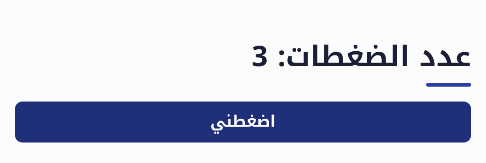
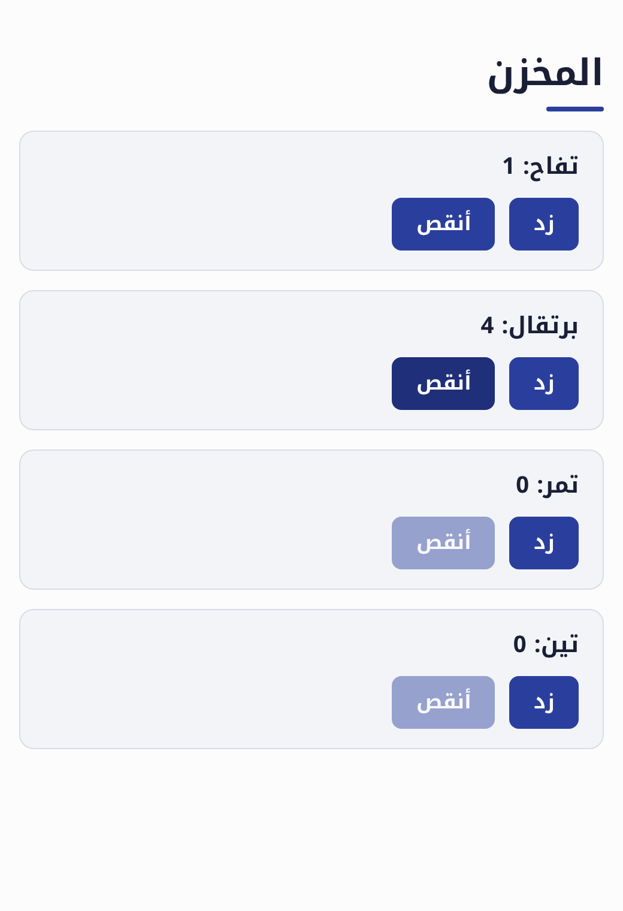

# ٨. صفحتك الأولى

حتى الآن كانت برامجك تطبع في الطرفية. في هذا الدرس تصنع صفحة ويب فيها أزرار وحقول، بلا
HTML ولا JavaScript: ضاد يتكفل بذلك، ويجعل الصفحة من اليمين إلى اليسار وبخط عربي جميل.

## «مكون»: قطعة من الصفحة

```dad title="عداد.dad"
مكون الرئيسية {
    حالة العدد = 0

    عمود {
        عنوان("عدد الضغطات: {العدد}")
        زر("اضغطني") { العدد += 1 }
    }
}
```

شغّله بـ`dad dev` بدلاً من `dad run`:

```sh
dad dev عداد.dad
```

أو بالعربية: `ضاد تطوير عداد.dad`.

ثم افتح <http://localhost:8080> في المتصفح، واضغط الزر: يزيد العدد في العنوان.

{ width="420" }

لنقرأ البرنامج:

- `مكون الرئيسية` يصف الصفحة. والمكون الذي اسمه `الرئيسية` هو ما يظهر حين تفتحها.
- `حالة العدد = 0` قيمة **يتذكرها** المكون. وكلما تغيرت الحالة رُسمت الصفحة من جديد.
- `عمود { … }` يضع ما بداخله بعضه تحت بعض، و`صف { … }` يضعه بعضه بجانب بعض.
- `زر("اضغطني") { … }` زر، وما بين `{ }` بعده يحدث عند الضغط عليه.

واترك `dad dev` يعمل: كلما حفظت الملف تحدّثت الصفحة وحدها.

## العناصر

| العنصر | ما هو |
|---|---|
| `عنوان("…")` | عنوان كبير. `عنوان("…"، مستوى: 2)` أصغر منه |
| `فقرة("…")` | فقرة نص |
| `زر("…") { … }` | زر. أضف `معطل: صح` ليتوقف عن العمل |
| `حقل(حالة)` | مكان للكتابة، مربوط بحالة. أضف `تلميح: "…"` ليظهر نص خفيف فيه |
| `مربع_اختيار(حالة، نص: "…")` | مربع يُعلَّم أو لا |
| `صورة("رابط")` و`رابط("النص"، "العنوان")` | صورة، ورابط إلى صفحة |
| `عمود` و`صف` و`بطاقة` | تجمع عناصر: تحت بعضها، أو بجانب بعضها، أو في إطار |
| `فاصل()` | خط أفقي |

## الحقول

الحقل مربوط بحالة: ما تكتبه فيه يصير قيمتها.

```dad title="تحية.dad"
مكون الرئيسية {
    حالة الاسم = ""
    حالة بالإنجليزية = خطأ

    بطاقة {
        عنوان("ما اسمك؟"، مستوى: 2)
        حقل(الاسم، تلميح: "اكتب اسمك هنا")
        مربع_اختيار(بالإنجليزية، نص: "بالإنجليزية")
        إذا الاسم != "" {
            فقرة(إذا بالإنجليزية { "Hello, {الاسم}!" } وإلا { "أهلاً بك يا {الاسم}!" })
        }
    }
}
```

لاحظ أن `إذا` تعمل داخل المكون كما تعمل في أي مكان: الفقرة لا تظهر إلا إذا كتبت اسماً.

## مكونات بمعاملات

المكون كالدالة: يأخذ معاملات، ويستعمله مكون آخر. ولكل نسخة منه حالتها الخاصة:

```dad title="عدادات.dad"
مكون عداد(الاسم: نص، البداية: صحيح = 0) {
    حالة العدد = البداية

    بطاقة {
        عنوان("{الاسم}: {العدد}"، مستوى: 3)
        صف {
            زر("زد") { العدد += 1 }
            زر("أنقص"، معطل: العدد == 0) { العدد -= 1 }
        }
    }
}

مكون الرئيسية {
    عمود {
        عنوان("المخزن")
        عداد("تفاح")
        عداد("برتقال"، البداية: 5)
        لكل الصنف في ["تمر"، "تين"] {
            عداد(الصنف)
        }
    }
}
```

{ width="420" }

## تمرين

اصنع صفحة «آلة حاسبة للبقشيش»: حقل لمبلغ الفاتورة، وثلاثة أزرار للنسب 10٪ و15٪ و20٪،
وفقرة تعرض البقشيش والمجموع.

??? note "الحل"

    ```dad title="بقشيش.dad"
    مكون الرئيسية {
        حالة الفاتورة = 0.0
        حالة النسبة = 15

        بطاقة {
            عنوان("حاسبة البقشيش"، مستوى: 2)
            حقل(الفاتورة، تلميح: "مبلغ الفاتورة")
            صف {
                لكل ن في [10، 15، 20] {
                    زر("{ن}٪"، معطل: النسبة == ن) { النسبة = ن }
                }
            }
            ثابت البقشيش = (الفاتورة * النسبة / 100).تقريب(2)
            فقرة("البقشيش {البقشيش}، والمجموع {الفاتورة + البقشيش}")
        }
    }
    ```

    ابدأ الحالة بـ`0.0` لا `0`، ليعرف الحقل أن المبلغ عدد عشري.

**التالي:** [حفظ البيانات](09-data.md)
