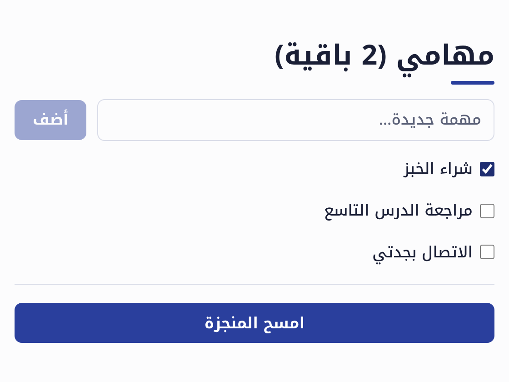

# 9. Saving data

If you close the counter page and open it again, the count is back at zero: state only
lives while the page is open. What has to last, such as tasks, orders or grades, belongs in a
**table**.

## `جدول`

```dad
جدول كتاب {
    العنوان: نص
    المؤلف: نص
    مقروء = خطأ
}

كتاب.أنشئ(العنوان: "الأيام"، المؤلف: "طه حسين")
كتاب.أنشئ(العنوان: "موسم الهجرة إلى الشمال"، المؤلف: "الطيب صالح")
ثابت الثلاثية = كتاب.أنشئ(العنوان: "ثلاثية غرناطة"، المؤلف: "رضوى عاشور")
الثلاثية.نسخة(مقروء: صح).احفظ()

اطبع("عدد الكتب:"، كتاب.عدد())
لكل ب في كتاب.الكل() {
    ثابت العلامة = إذا ب.مقروء { "✓" } وإلا { "·" }
    اطبع(العلامة، ب.رقم، ب.العنوان، "—"، ب.المؤلف)
}
اطبع("المقروءة:"، كتاب.حيث { هو.مقروء }.حول { هو.العنوان })
```

``` { .text .dad-out }
عدد الكتب: 3
· 1 الأيام — طه حسين
· 2 موسم الهجرة إلى الشمال — الطيب صالح
✓ 3 ثلاثية غرناطة — رضوى عاشور
المقروءة: [«ثلاثية غرناطة»]
```

- `جدول كتاب { … }` («table book») describes records the way `نوع` does. Each field has a
  type (`العنوان: نص`, the title) or a default its type comes from (`مقروء = خطأ`, «read» is
  false).
- Ḍād adds a field called `رقم` («number») to every record, and gives it a new value when the
  record is saved.
- `كتاب.أنشئ(…)` creates a record and saves it, `كتاب.الكل()` returns all of them,
  `كتاب.حيث { … }` the ones the condition is true for, and `كتاب.بالرقم(2)` a single one.
- `السجل.احفظ()` saves what changed, and `السجل.احذف()` deletes the record.

Run the program twice with `dad run` and look at «عدد الكتب» (the number of books): it doesn't
go back to three, it grows, because the books are saved. Ḍād keeps the data in a file next
to your program, in a folder called `.dad`. Delete that folder to start again.

## A to-do app

Let's put together everything you have learned in a real app: a table of tasks, functions
that run on the **server**, and a page.

```dad title="مهامي.dad"
جدول مهمة {
    العنوان: نص
    منجزة = خطأ
}

خادم دالة كل_المهام() = مهمة.الكل()
خادم دالة أضف(العنوان: نص) = مهمة.أنشئ(العنوان: العنوان)
خادم دالة بدّل(م: مهمة) = م.نسخة(منجزة: ليس م.منجزة).احفظ()
خادم دالة امسح_المنجزة() = مهمة.حيث { هو.منجزة }.لكل { هو.احذف() }

مكون الرئيسية {
    حالة المهام = كل_المهام()
    حالة الجديدة = ""

    عمود {
        ثابت الباقية = المهام.عدد { ليس هو.منجزة }
        ثابت فيها_منجزة = الباقية < المهام.عدد
        عنوان("مهامي ({الباقية} باقية)")
        صف {
            حقل(الجديدة، تلميح: "مهمة جديدة…")
            زر("أضف"، معطل: الجديدة.قص() == "") {
                أضف(الجديدة.قص())
                الجديدة = ""
                المهام = كل_المهام()
            }
        }
        لكل م في المهام {
            مربع_اختيار(م.منجزة، نص: م.العنوان) {
                بدّل(م)
                المهام = كل_المهام()
            }
        }
        إذا فيها_منجزة {
            فاصل()
            زر("امسح المنجزة") {
                امسح_المنجزة()
                المهام = كل_المهام()
            }
        }
    }
}
```

```sh
dad dev مهامي.dad
```

{ width="460" }

What's new here?

- A `خادم دالة` is a function that runs on the server, where the table is. The page calls it
  like any other function.
- After each change we read the tasks again: `المهام = كل_المهام()`. The state changes, and
  the page is drawn again.
- `مربع_اختيار(م.منجزة) { … }` gives you a place to write what happens when it is clicked.

Open the app in two windows, add a task in one and reload the other: the task is there,
because both windows read the same table.

### The developer page

While `dad dev` runs, open <http://localhost:8080/_dad>. It shows your tables and what is in
them, and your server functions with a form to try each one. It updates by itself.

## Exercise

Add a priority to the to-do app: a field `عاجلة = خطأ` («urgent»), a check box next to the
new-task field to set it, and show urgent tasks first, with «!» before each title.

??? note "Hint"

    Add `عاجلة: منطقي = خطأ` to the parameters of `أضف`, and a state `حالة العاجلة = خطأ` to
    the component. To order the tasks, join two lists:
    `المهام.رشح { هو.عاجلة } + المهام.رشح { ليس هو.عاجلة }`.

**Next:** [Going online](10-online.md)
